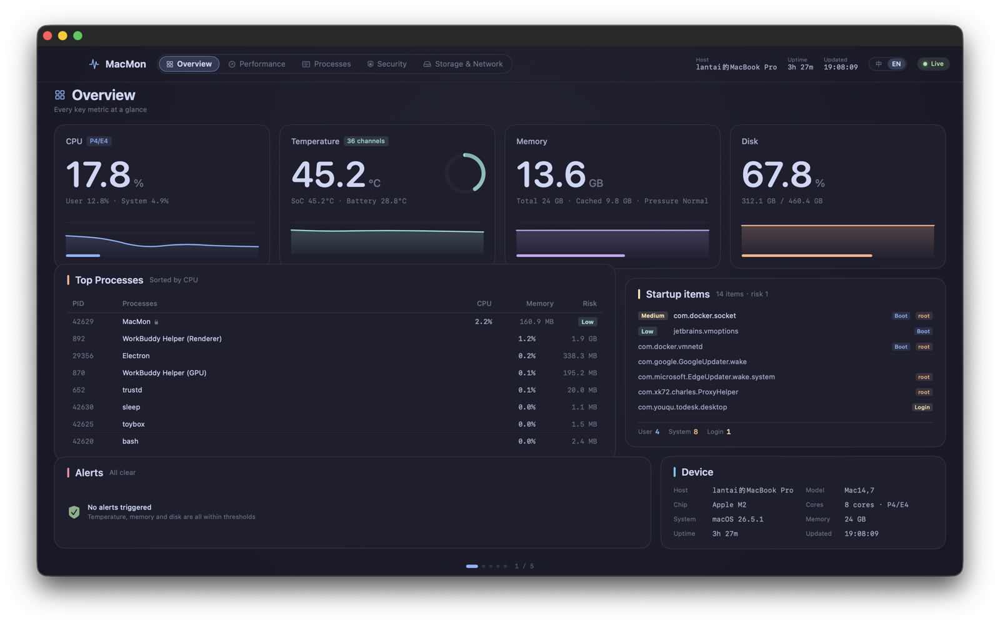
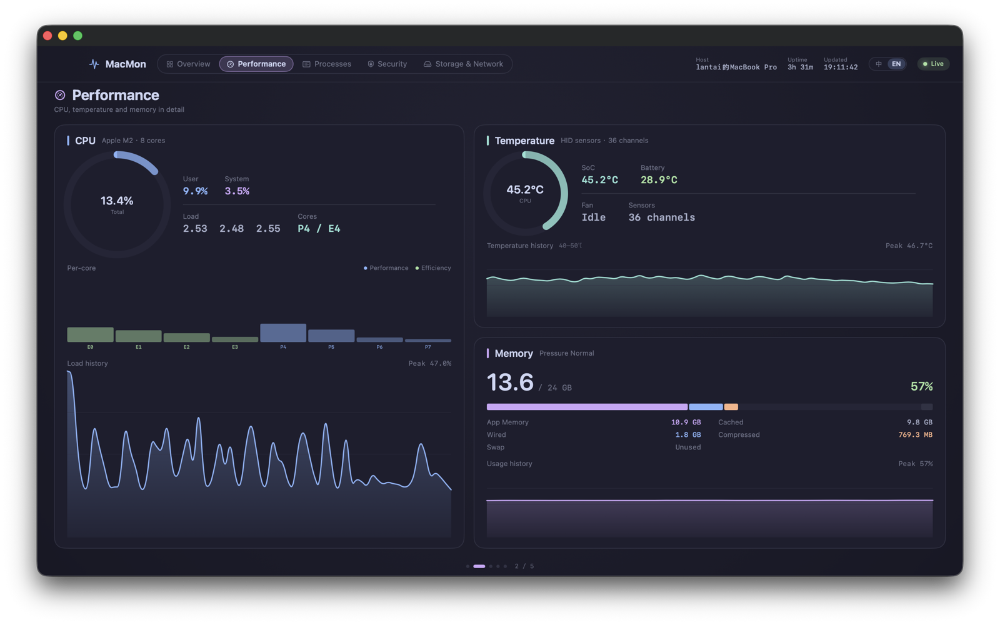
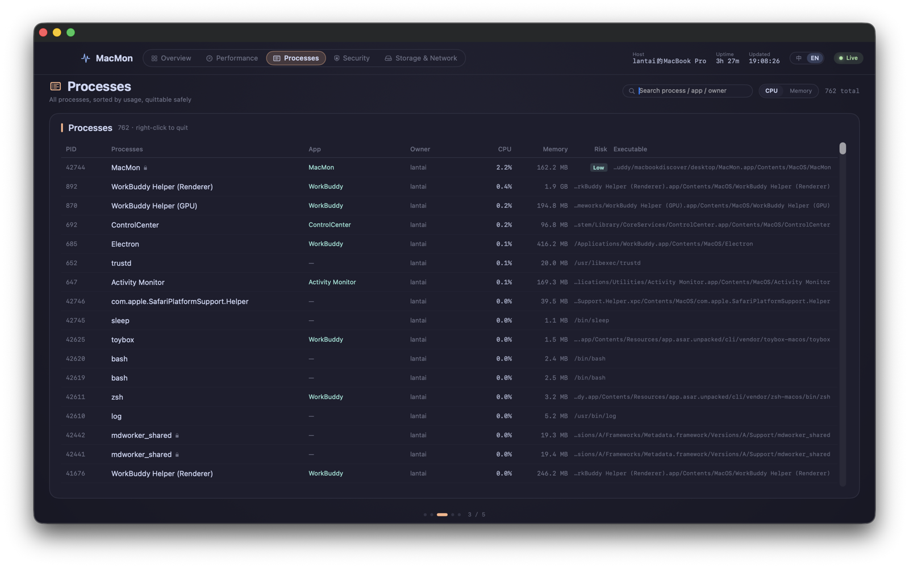
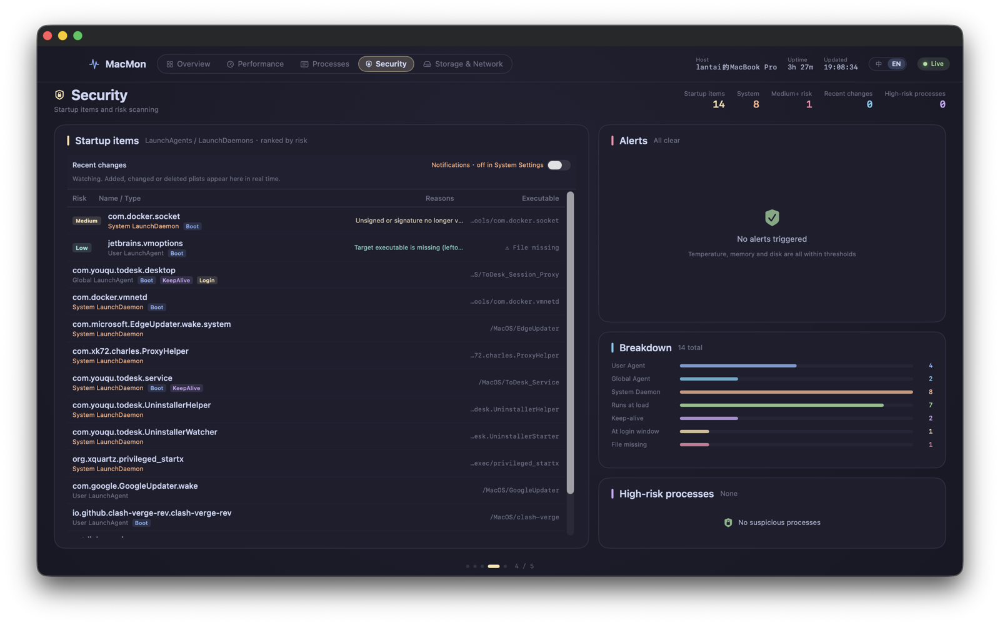
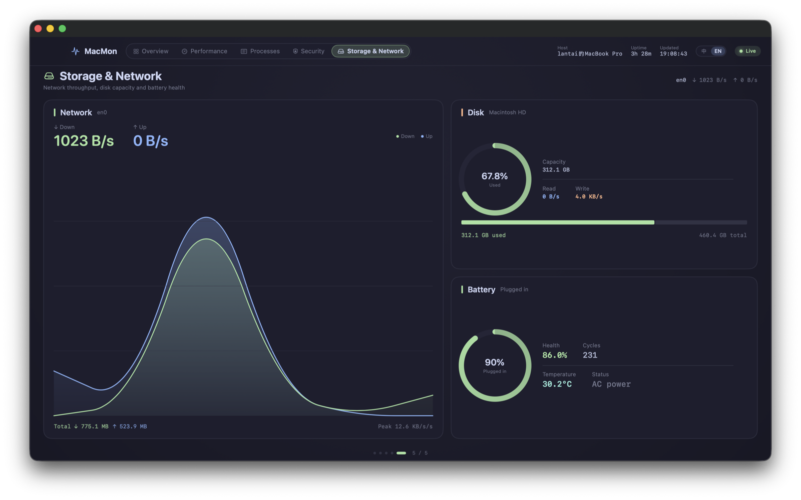

# MacMon

**English** · [简体中文](README.zh-CN.md)


A native macOS system monitor built with SwiftUI. Every metric comes straight from
`sysctl`, `libproc`, `IOKit` and `IOHIDEventSystemClient` — no helper daemons, no
shelling out, no third-party packages, and **no network code at all**.

Five full-page views you move through like a dashboard, plus a menu bar extra.
Memory accounting matches Activity Monitor item by item. Startup items are audited
*and* watched in real time, so you see what appeared five seconds ago, not just
what exists right now. The UI switches between English and Chinese at runtime.



## Features

- **Zero dependencies, zero subprocesses.** `Package.swift` links only system
  frameworks. Collection never spawns `ps`, `vm_stat` or `ioreg`.
- **Zero network code.** No `URLSession`, `NWConnection`, `CFStream` or raw sockets.
  Signature checks are offline (`SecStaticCodeCheckValidity` with empty flags, so no
  OCSP/CRL traffic). Nothing leaves the machine.
- **Activity Monitor–compatible memory accounting.** Uses the *object* accounting
  (`internal` / `external`) instead of the queue accounting (`active` / `inactive`),
  avoiding the 2–3 GB overestimate most `vm_stat` parsers report.
  See [Memory accounting](#memory-accounting).
- **Real-time startup item monitoring.** One `FSEventStream` watches three
  persistence directories; a debounced diff turns file events into
  "added / removed / field changed" records, persisted to disk and surfaced as
  in-app alerts plus optional system notifications.
- **Risk scoring without the cost.** 700+ processes are scored by path heuristics,
  with a capped signing-verification budget so the collection loop stays responsive.
- **Safe process termination.** A blacklist, owner check and pre-computed
  killability keep you from killing `WindowServer` or the app itself.
- **Adaptive charts.** The temperature sparkline uses a window centered on the
  current value instead of a fixed 0–110 °C scale, and prints the range on the card.
- **Keyboard reachable.** Five pages, `⌘1`–`⌘5`, `⌘[` / `⌘]`, and CLI flags for
  fully scriptable screenshots.
- **Bilingual UI (English / 简体中文).** The `中 / EN` pill in the top bar switches
  the entire interface instantly — no restart, no relaunch. First launch follows the
  system language; the choice is remembered afterwards. Also settable from the
  command line (`--lang en`) or `MACMON_LANG`, which is how the screenshot pair
  below was produced from a single build. Adding a language means filling in one
  dictionary, not touching view code.
- **No dead menu items.** The app menu is trimmed at launch: no Services submenu
  (every item in it came from Instruments, not from this app), no empty Format,
  Window or Help menus, no AutoFill / Dictation / Emoji clutter in Edit. What is left
  is About / Hide / Quit, a five-item Edit menu, Enter Full Screen, and the Pages menu.
  See [the design notes](docs/DESIGN.md#menus-what-swiftui-leaves-behind) for why this
  needs pruning code rather than a SwiftUI modifier.

## Compared with Activity Monitor

Activity Monitor is the reference implementation, so "why build another one" deserves a
real answer rather than a shrug about reinventing the wheel.
The short version: it reproduces the memory numbers with the same definitions, and adds
what Activity Monitor has no counterpart for — temperature, fan speed, battery health,
startup item auditing, startup change history, and startup risk scoring.

| Capability | Activity Monitor | MacMon |
|---|---|---|
| Memory breakdown (app / wired / compressed / cached / swap) | Yes | Yes — same definitions, verified item by item |
| Memory pressure | Yes, with a graph | Yes, as a level (`kern.memorystatus_vm_pressure_level`) |
| Per-process CPU, threads, memory | Yes | Yes |
| System process CPU (`WindowServer`, `launchd`) | Yes | **No** — reads 0% |
| Per-process disk I/O | Yes | No |
| Per-process network | Yes | No |
| Energy impact | Yes | No |
| GPU utilization | Yes | No (GPU temperature only) |
| Sample process / spindump / system diagnostics | Yes | No |
| **Temperature** (CPU / SoC / GPU / battery) | No | Yes — 36 HID sensors, maximum taken |
| **Fan speed** | No | Yes |
| **Battery health and cycle count** | No | Yes |
| **Startup item inventory** (`LaunchAgents` / `LaunchDaemons`) | No — there is no startup tab | Yes, with signature and target-binary checks |
| **Startup change history** | No | Yes — FSEvents, second-level latency, persisted to disk |
| **Startup risk scoring** (ad-hoc, unsigned, suspicious path) | No | Yes |
| Guarded process termination | Force quit, no pre-flight check | Same effect, but the button is disabled before you click it |
| Menu bar readout | Dock icon graph only | Menu bar extra |

### Where Activity Monitor wins

Plainly: it reads system processes' CPU (its helpers carry a private entitlement),
it attributes disk and network I/O per process, and it has energy impact, GPU usage
and process sampling. If the question is "which process is hammering the disk right
now", use Activity Monitor.

What it cannot answer is "what got installed into my boot sequence, and when".
That is the gap this app fills.

## Screenshots

Captured from this build in both languages — same code, same machine, only the UI
language differs. Files live under [`screenshots/`](screenshots).

**English** (`screenshots/en/`)

| Page | Preview |
|---|---|
| Overview |  |
| Performance |  |
| Processes |  |
| Security |  |
| Storage & Network |  |

**简体中文** (`screenshots/zh-CN/`) — see [README.zh-CN.md](README.zh-CN.md) for the
Chinese README with the same five screenshots inline.

## Requirements

| | |
|---|---|
| macOS | 14.0 (Sonoma) or later |
| Toolchain | Swift 5.10+ — Xcode 15+ **or** the standalone Command Line Tools |
| Dependencies | none (system frameworks only) |

This is a Swift Package, not an Xcode project. There is no `.xcodeproj` to open;
`Package.swift` is the whole build definition.

## Build and run

```bash
git clone https://github.com/karuidu/MacMon.git
cd MacMon

swift build -c release     # binary only: .build/release/MacMon
./build-app.sh             # assemble MacMon.app (ad-hoc signed, ~3.5 MB)
open MacMon.app
```

`build-app.sh` writes `Info.plist` (`com.macmon.desktop`, `LSMinimumSystemVersion`
14.0), packs the icon from `assets/AppIcon.icns`, and ad-hoc signs the bundle.

> **Gatekeeper note.** The bundle is ad-hoc signed, not notarized. If you downloaded
> it as an archive rather than building it yourself, macOS will refuse the first
> launch. Either right-click → **Open**, or clear the quarantine attribute:
>
> ```bash
> xattr -dr com.apple.quarantine MacMon.app
> ```

## Usage

### Pages

| # | Page | Shortcut | Contents |
|---|---|---|---|
| 1 | Overview | `⌘1` | CPU / temperature / memory / disk hero cards, top processes, startup items, alerts, device info |
| 2 | Performance | `⌘2` | Per-core load, 36 temperature sensors, fan speed, memory breakdown and history |
| 3 | Processes | `⌘3` | All processes with search, sort by CPU/memory, terminate with guardrails |
| 4 | Security | `⌘4` | Startup items ranked by risk, recent change feed, alerts, risk composition |
| 5 | Storage & Network | `⌘5` | Network throughput, disk capacity and I/O, battery health |

Navigation works three ways, simultaneously:

- Click a pill in the top bar, or press `⌘1`–`⌘5`
- `⌘[` / `⌘]` for previous / next page
- Two-finger horizontal swipe, horizontal mouse scroll, or drag the page itself

A dot indicator at the bottom shows the current position. Minimum window
1000×680, default 1480×900.

### Menu bar

The menu bar extra shows live CPU and memory. Its button is two-state:

- **Open dashboard** when the window is hidden or was closed — the window object is
  reused, not recreated, so its page and size survive
- **Hide dashboard** when the window is on screen (`orderOut`, so closing it does
  not also collapse the menu bar panel)

### CLI flags and environment variables

Useful for screenshot automation and headless verification:

```bash
MACMON_PAGE=security MACMON_WINDOW=1400x860 ./MacMon.app/Contents/MacOS/MacMon

./MacMon.app/Contents/MacOS/MacMon --page storage
./MacMon.app/Contents/MacOS/MacMon --lang en --page processes
./MacMon.app/Contents/MacOS/MacMon --diagnose
./MacMon.app/Contents/MacOS/MacMon --window-selftest
```

| Flag | Effect |
|---|---|
| `--page <name>` / `--page=<name>` | Start on a given page. Accepts `overview` `performance` `processes` `security` `storage`, the Chinese page titles, or `1`–`5` |
| `MACMON_PAGE` | Same as `--page`; the flag wins when both are present |
| `--lang <code>` / `--lang=<code>` | Start in `en` or `zh`. Overrides the saved preference **and is not persisted**, so a script can flip languages without disturbing the user's setting |
| `MACMON_LANG` | Same as `--lang`; the flag wins when both are present |
| `MACMON_WINDOW=WxH` | Force the window size (honored only at process start) |
| `--diagnose` | Print each collector's real output plus a self-check line, then exit. Runs before the UI loads, so it works over SSH |
| `--menus` | Print the live menu tree (titles, shortcuts, nesting) and exit. The menu counterpart to `--diagnose` |
| `--window-selftest` | Scripted show → hide → show → simulate red-button close → reopen, printing window count and frame at each step, then exit |

`--diagnose` is the fastest way to verify a build actually collects data:

```
内存  : 已用 14.16 / 24.0 GB (59.0%)  App 11.75 缓存 8.95 固定 1.63 压缩 0.57 可清除 0.18 空闲 0.88  压力 正常
        自检: 各项合计 24.00 GB，与物理内存偏差 +0.0%
```

## How it works

### Data sources

| Metric | Source |
|---|---|
| Process list | `sysctl KERN_PROC_ALL` |
| Per-process CPU / RSS / threads | `proc_pidinfo` + `proc_pid_rusage` |
| Executable path | `proc_pidpath` |
| Code signing / risk | `SecCodeCopySigningInformation` + path and owner heuristics |
| CPU load, per core | `host_processor_info` |
| Memory | `host_statistics64` (see below) |
| Temperature | `IOHIDEventSystemClient`, 36 sensors, maximum taken |
| Battery | IOKit `AppleSmartBattery` |
| Network | `sysctl PF_ROUTE` / `NET_RT_DUMP` + `RTM_IFINFO2` |
| Disk I/O | `IOBlockStorageDriver` cumulative byte delta |
| Startup items | `/Library/Launch*`, `~/Library/LaunchAgents`, login items; each verified for signature and file existence |
| Startup changes | FSEvents (`FSEventStreamCreate`, one stream over three directories) |
| System info | `sysctl hw.*`, `SystemVersion.plist` |

`CProc` is a thin C target. `libproc.h` and `sys/proc_info.h` are not part of the
Darwin module, so they are bridged through a single header that only includes the
system header — no implementation.

### Memory accounting

`vm_stat` exposes two different decompositions, and mixing them costs 2–3 GB:

- **Queue accounting** — `active` / `inactive` / `speculative` / `free`
- **Object accounting** — `internal` (anonymous pages) / `external` (file-backed cache)

`active_count` includes a large amount of file-backed cache, which is exactly what
Activity Monitor reports separately as *Cached Files*. MacMon therefore uses object
accounting and aligns item by item:

```
App Memory   = internal − purgeable
Memory Used  = internal + wired + compressed
Cached Files = external
Free         = physical − used − cached
Wired / Compressed / Swap = wire / compressor / vm.swapusage
```

> "Fixed" in the UI is what Activity Monitor calls **Wired** memory: locked in RAM,
> cannot be paged out or compressed, mostly kernel, drivers and I/O buffers. The UI
> uses the clearer label and explains it on hover.

Measured on a 24 GB machine: Activity Monitor reports 9.50 / 7.21 / 11.39 GB, and
MacMon reports 9.50 / 7.21 / 11.39 GB. The old formula
(`active + wired + compressed`) would have reported **12.3 GB / 51%** at the same
moment — about 2.8 GB too high.

`--diagnose` prints every component plus a self-check:
`App + purgeable + cached + wired + compressed + free` must equal physical memory
(±0.0% is expected).

### Startup item monitoring

Polling tells you *what exists*. It cannot tell you *what just appeared*, which is
the more interesting question — normal users do not install new login daemons every
day. MacMon pairs a **real-time FSEvents watcher with a 60 s polling fallback**:

| Stage | Implementation |
|---|---|
| Watch | One `FSEventStream` over three directories, 0.4 s latency, events carry concrete paths |
| Debounce | Coalesce on a 1.0 s tail with a 3.0 s hard cap so a long copy cannot defer forever |
| Fallback | Full rescan every 60 snapshot cycles (waking from sleep and queue backlog can drop events) |
| Diff | Keyed on `plistPath`, comparing only behaviour-relevant fields |
| Surface | Change strip at the top of the page (3 latest), alert panel, "recent changes" counter |
| Persist | `~/Library/Application Support/MacMon/startup-changes.json`, last 20 records |
| Notify | In-app alerts always; system notifications behind an opt-in switch, off by default |

Risk scoring is additive and capped at 100: suspicious path +40, unsigned or
invalid signature +40, ad-hoc signature +35, missing target binary +25, `RunAtLoad`
+ `KeepAlive` outside `/Applications` or `/Library` +20, loads at login window +15,
root daemon +8. Levels: `<20` none, `20–39` low, `40–64` medium, `65–84` high,
`85+` critical.

### Notifications

Three constraints shaped the implementation:

- **Authorization is only requested when the user flips the switch.**
  `requestAuthorization` gets one shot per bundle ID; asking at launch and getting
  refused kills the feature permanently.
- **It must run as a `.app`.** A bare binary has no bundle, and
  `UNUserNotificationCenter.current()` throws
  `bundleProxyForCurrentProcess is nil`. Every access is guarded by
  `Bundle.main.bundleIdentifier`.
- **`willPresent` must return `[.banner, .list, .sound]`**, otherwise foreground
  notifications are silently dropped — the most common false negative when testing.

### Localization

Localization does **not** use `.lproj` bundles or `NSLocalizedString`. Under
SwiftPM, resources are compiled into `MacMon_MacMon.bundle`, while SwiftUI's
`Text("key")` only consults `Bundle.main` — the lookup silently returns the key
instead of the translation, and runtime switching never works.

Instead there is one central table and two functions:

```swift
enum L {
    static var current: AppLanguage = .zh
    static func t(_ zh: String) -> String       // lookup, falls back to the Chinese key
    static func f(_ zh: String, _ args: Any...) // same, with %@ positioned substitution
}
```

The Chinese string doubles as the dictionary key, so an untranslated string renders
in Chinese rather than as a raw identifier — a missing entry degrades gracefully and
is visible in the UI instead of in the console. 216 entries cover all five pages,
the menu bar panel, alerts, and change notifications.

Two rules that are easy to get wrong:

- **Never localize a persisted value.** `RiskLevel`, `SigningKind`, `StartupKind`
  and the diff field names (`"风险等级"`, `"可执行文件存在"`) are written to JSON.
  Their `rawValue` stays a stable English identifier with a separate `label` for
  display, and `fromStored(_:)` maps legacy on-disk Chinese back to a case.
- **Rebuild the view tree on language change.** `.id(language.language)` on the
  view body forces SwiftUI to re-evaluate every `Text`. It must go *inside* the
  view, never on the `Window` / `MenuBarExtra` scene root — on a scene root the
  window stops appearing entirely.

### Icon

`assets/make-icon.swift` draws the icon with Core Graphics on a 1024 canvas, placing
an 824×824 squircle (corner radius 186 ≈ 0.2256 × 824) in the centre — the macOS Big
Sur icon grid — with a baked drop shadow and a top-light gradient. The glyph is the
same pulse the menu bar uses, rendered as a neon tube: a wide low-alpha glow, a
cyan→periwinkle body, and a thin white core.

`assets/build-icon.sh` renders **every size separately** rather than downsampling one
master. A real ECG's two small waves only become blobs at 16–32 px, so those sizes
drop them and thicken the stroke. Edit the generator, run it, then `./build-app.sh`.

## Project structure

```
Package.swift              SwiftPM manifest — the whole build definition
Sources/
├── CProc/                 Thin C bridge for libproc.h / sys/proc_info.h
├── MacMon/
│   ├── App/               MacMonApp (scenes), AppModel (collection loop),
│   │                      NavigationModel, AppDelegate, WindowBridge, Diagnostics,
│   │                      L10n (language store + L.t / L.f), Translations (EN table),
│   │                      MenuLayout (menu pruning)
│   ├── Collectors/        CollectorHub + CPU / memory / temperature / disk /
│   │                      network / battery / process / startup collectors
│   ├── Startup/           StartupWatcher (FSEvents + debounce),
│   │                      StartupDiff (pure functions), StartupChangeStore (JSON),
│   │                      StartupNotifier (UNUserNotificationCenter)
│   ├── Security/          RiskEngine, SecurityAudit, AppResolver, KillService
│   ├── Models/            Metric and risk models
│   └── Views/             DashboardView, Pages/, Cards/, Widgets/, Theme
build-app.sh               Assemble and ad-hoc sign MacMon.app
assets/make-icon.swift     Icon generator — Core Graphics, 1024 canvas, no dependencies
assets/build-icon.sh       Renders every icon size and packs assets/AppIcon.icns
docs/DESIGN.md             Design decisions and hard-won gotchas
screenshots/en/            English UI, five pages
screenshots/zh-CN/         Chinese UI, five pages
```

Roughly 7,000 lines of Swift across 40 files, plus one C bridging header.

## Known limitations

- **System processes always show 0% CPU** (`WindowServer`, `launchd`, …). `/bin/ps`
  is setuid root and carries the private
  `com.apple.system-task-ports.read` entitlement; an ordinary app cannot read their
  task ports. An OS restriction, not a bug.
- **No blocking capability.** The only synchronous process gate on macOS is
  EndpointSecurity, which needs an Apple-approved entitlement
  (`com.apple.developer.endpoint-security.client`) unavailable to individual
  developers. MacMon is post-hoc detection with second-level latency, not an
  "allow or block?" prompt.
- **Changes made while MacMon is not running are lost.** Only change events are
  persisted, not the full previous snapshot, so there is nothing to diff against on
  the next launch — it re-seeds a baseline instead.
- **No rollback.** Diffs record field-level changes (`RunAtLoad: false → true`), not
  whole plists, so old configurations cannot be restored.
- **Signature checks are offline** and never query a hash reputation service,
  by design.
- **Touchpad swipe cannot be automated.** Synthesizing scroll events requires
  Accessibility permission; the code path exists and does not swallow vertical
  scrolling, but it has to be confirmed by hand.
- **Two UI languages only** (English, Simplified Chinese), and the switch is not
  per-page: it repaints the whole tree at once. There is also no date/time
  formatting layer, so `19:08:09` style timestamps are identical in both.

## Development notes

Design decisions and the traps behind them — the hand-rolled pager, why
`canBecomeMain` breaks "open dashboard", why the diff key is `plistPath` and not
`StartupItem.id` — live in [`docs/DESIGN.md`](docs/DESIGN.md)
([中文](docs/DESIGN.zh-CN.md)).

## Roadmap

- [x] Localize the UI (English + Chinese), runtime switch, no restart
- [ ] Third UI language — the table is the only thing to add
- [ ] Persist the full startup snapshot so offline changes can be detected
- [ ] Export sparkline history (CSV) for post-mortem analysis
- [ ] Optional numeric readout in the menu bar instead of icon-only

## Contributing

Issues and pull requests are welcome. Before opening a PR:

1. `swift build -c release` must finish with **zero warnings** — this project keeps
   the build clean on purpose.
2. If you touch a collector, paste the relevant `--diagnose` output in the PR
   description so the numbers can be checked against Activity Monitor or `top`.
3. If you touch window or notification code, run `--window-selftest` and include
   its output.
4. New user-facing strings go through `L.t("中文原文")` / `L.f("… %@ …")` and get one
   line in `App/Translations.swift`. Do not add a literal `Text("中文")` — the
   coverage check (`grep` for CJK outside the allowed files) will catch it.

There is no test target: verification is `--diagnose` (collectors) and
`--window-selftest` (window lifecycle). Both are scriptable.

## License

[MIT](LICENSE) © 2026 lantai

## Acknowledgements

Apple's Activity Monitor for the memory accounting reference. Collection approach
inspired by `htop`, `btop` and `stats` (exelban).
