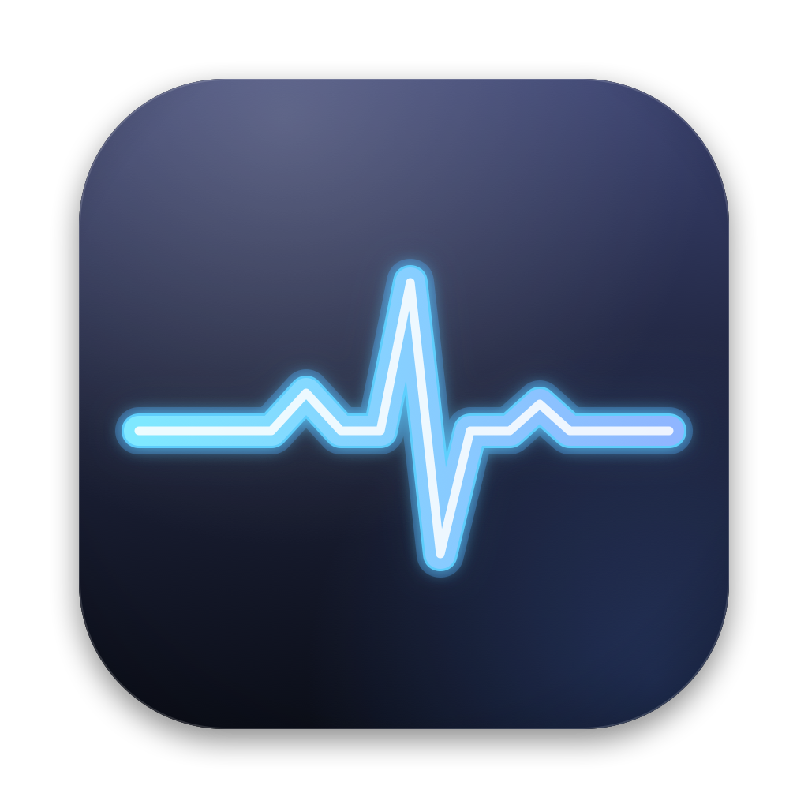
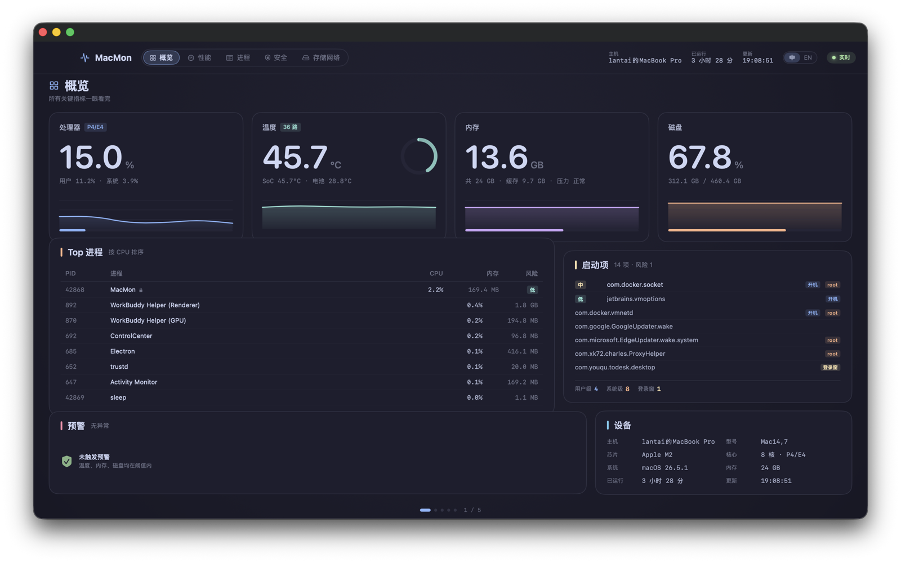
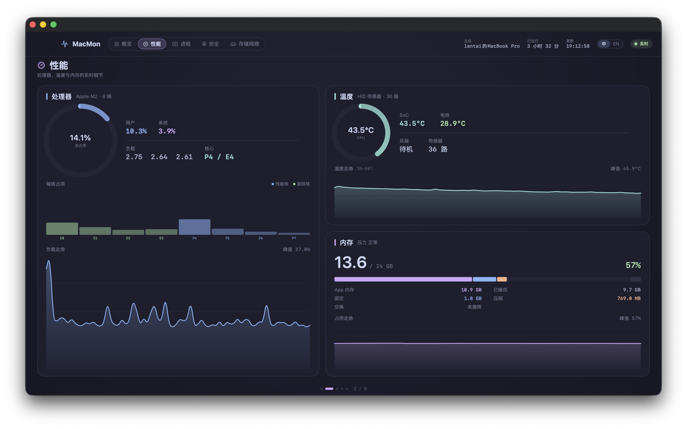
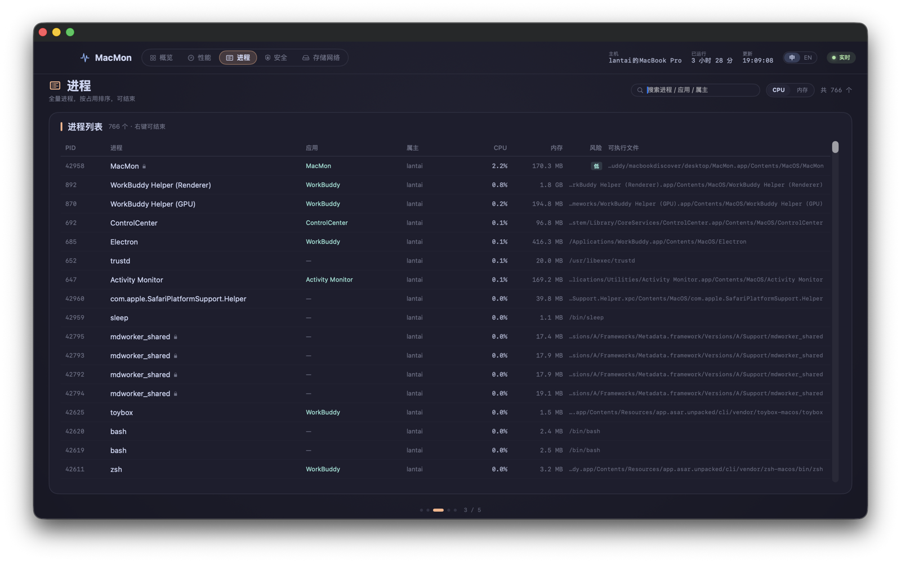
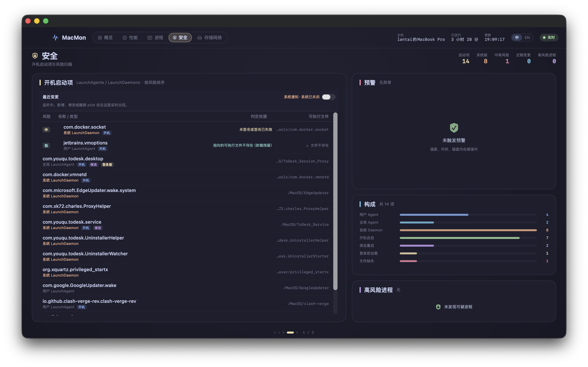
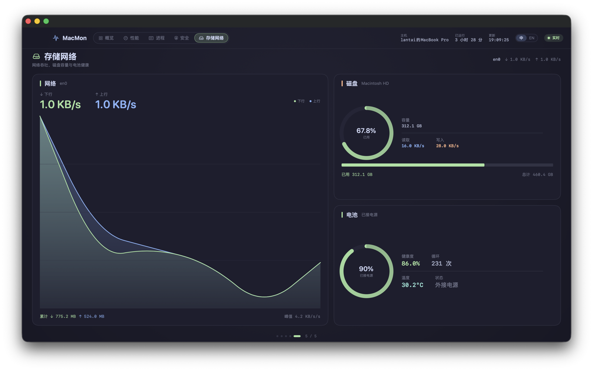

# MacMon

[English](README.md) · **简体中文**




纯 SwiftUI 写的原生 macOS 监控台。所有指标直接来自 `sysctl`、`libproc`、`IOKit` 与
`IOHIDEventSystemClient`——不起辅助进程、不 shell 出去调 `ps`/`vm_stat`、不引入任何第三方包，
而且**整份代码零网络请求**。

五个整页视图像大屏一样横向翻动，外加一个菜单栏常驻入口。内存口径与活动监视器逐项对齐；
启动项不只会审计，还会实时盯着——能看到「五秒前刚多出来的那个」，而不只是「现在有什么」。
界面支持中英文运行中即时切换。



## 特性

- **零依赖、零子进程。** `Package.swift` 只链接系统框架，采集过程从不派生 `ps`、`vm_stat`、`ioreg`。
- **零网络代码。** 没有 `URLSession`、`NWConnection`、`CFStream` 或裸 socket。签名校验是离线的
  （`SecStaticCodeCheckValidity` 传空 flag，不会走 OCSP/CRL）。没有任何数据离开本机。
- **与活动监视器一致的内存口径。** 用**对象口径**（`internal` / `external`）而不是队列口径
  （`active` / `inactive`），避开大多数 `vm_stat` 解析器高估 2–3 GB 的老问题。
  见 [内存口径](#内存口径)。
- **启动项实时监控。** 一条 `FSEventStream` 看住三个持久化目录，尾部防抖后做差异比对，
  产出「新增 / 移除 / 字段变更」记录，落盘并同时投递到应用内告警与可选系统通知。
- **风险评分不拖慢采集。** 700+ 个进程靠路径启发式评分，验签有数量预算上限，采集循环始终跟得上秒级节奏。
- **安全结束进程。** 黑名单 + 属主校验 + 预先算好的可结束性，碰不到 `WindowServer`，也杀不掉自己。
- **自适应图表。** 温度走势不再用固定 0–110℃，而是**以当前值为中心**取窗口，并把区间标在卡片上。
- **键盘可达。** 五页、`⌘1`–`⌘5`、`⌘[` / `⌘]`，外加命令行参数，截图验收可全自动。
- **中英双语界面。** 顶栏的「中 / EN」胶囊点一下即整界面切换，不重启、不重开窗口。首次启动跟随系统语言，
  之后记住选择。也可以用 `--lang en` 或 `MACMON_LANG` 从命令行指定——下面这组成对截图
  就是同一份构建跑出来的。新增一门语言只需要补一份字典，不用碰任何 View 代码。
- **菜单里没有死项。** 启动时把菜单裁一遍：「服务」子菜单整块去掉（里面每一条都来自 Instruments，
  不是本 App 的），去掉空的「格式」「窗口」「帮助」，再去掉「编辑」里的自动填充 / 听写 / 表情与符号。
  剩下的就是 关于 / 隐藏 / 退出、五项「编辑」、一条「进入全屏」和「页面」。
  为什么要写代码裁而不是加个 SwiftUI 修饰符，见
  [设计笔记](docs/DESIGN.zh-CN.md#菜单swiftui-留下的东西)。

## 与活动监视器的区别

活动监视器是这个领域的参考实现，所以「为什么还要再写一个」值得认真想一想，
不能一句「重复造轮子」就打发过去。
答案是：它用同一套定义复现了内存口径，另外补了活动监视器完全没有的东西——
温度、风扇转速、电池健康、启动项审计、启动项变更历史，以及启动项风险评分。

| 能力 | 活动监视器 | MacMon |
|---|---|---|
| 内存分项（App / 固定 / 压缩 / 已缓存 / 交换） | 有 | 有 —— 同一套定义，逐项核对过 |
| 内存压力 | 有，带走势图 | 有，显示为等级（`kern.memorystatus_vm_pressure_level`） |
| 单进程 CPU / 线程 / 内存 | 有 | 有 |
| 系统进程 CPU（`WindowServer`、`launchd`） | 有 | **没有** —— 恒读 0% |
| 单进程磁盘 I/O | 有 | 没有 |
| 单进程网络 | 有 | 没有 |
| 能耗影响 | 有 | 没有 |
| GPU 占用率 | 有 | 没有（只有 GPU 温度） |
| 采样进程 / spindump / 系统诊断 | 有 | 没有 |
| **温度**（CPU / SoC / GPU / 电池） | 没有 | 有 —— 36 路 HID 传感器取最高值 |
| **风扇转速** | 没有 | 有 |
| **电池健康度与循环次数** | 没有 | 有 |
| **启动项清单**（`LaunchAgents` / `LaunchDaemons`） | 没有 —— 它根本没有启动项页签 | 有，且逐项验签、检查目标二进制是否存在 |
| **启动项变更历史** | 没有 | 有 —— FSEvents，秒级延迟，落盘 |
| **启动项风险评分**（ad-hoc / 未签名 / 可疑路径） | 没有 | 有 |
| 带护栏的结束进程 | 强制退出，点下去才生效 | 效果相同，但按钮在点之前就已禁用并说明原因 |
| 菜单栏读数 | 只有 Dock 图标曲线 | 有菜单栏常驻入口 |

### 活动监视器更强的地方

直说：它能读系统进程的 CPU（它的辅助进程带私有 entitlement），能把磁盘和网络 I/O
归到单个进程，还有能耗影响、GPU 占用和进程采样。如果你的问题是「现在哪个进程在猛读写磁盘」，
请用活动监视器。

它回答不了的是「我的开机启动序列里，什么时候多了个什么东西」。这正是这个 App 补的缺口。

## 截图

同一份构建、同一台机器，只切了界面语言。文件都在 [`screenshots/`](screenshots) 下。

**简体中文**（`screenshots/zh-CN/`）

| 页面 | 预览 |
|---|---|
| 概览 |  |
| 性能 |  |
| 进程 |  |
| 安全 |  |
| 存储网络 |  |

**English**（`screenshots/en/`）—— 英文版 README 里同样五张内嵌，见 [README.md](README.md)。

## 环境要求

| | |
|---|---|
| macOS | 14.0 (Sonoma) 及以上 |
| 工具链 | Swift 5.10+，完整 Xcode 15+ **或**独立的 Command Line Tools 均可 |
| 依赖 | 无（只链接系统框架） |

这是 Swift Package，不是 Xcode 工程。仓库里没有 `.xcodeproj`，`Package.swift` 就是全部构建定义。

## 构建与运行

```bash
git clone https://github.com/karuidu/MacMon.git
cd MacMon

swift build -c release     # 只编译，产物在 .build/release/MacMon
./build-app.sh             # 组装 MacMon.app（ad-hoc 签名，约 3.5 MB）
open MacMon.app
```

`build-app.sh` 会写入 `Info.plist`（`com.macmon.desktop`、`LSMinimumSystemVersion` 14.0），
从 `assets/AppIcon.icns` 打包图标，最后做 ad-hoc 签名。

> **Gatekeeper 提示。** 产物是 ad-hoc 签名、没有公证。如果你是下载压缩包而不是自己编译的，
> 首次双击会被系统拒绝。右键 → **打开**，或者清掉隔离属性：
>
> ```bash
> xattr -dr com.apple.quarantine MacMon.app
> ```

## 使用

### 五个页面

| # | 页面 | 快捷键 | 内容 |
|---|---|---|---|
| 1 | 概览 | `⌘1` | CPU / 温度 / 内存 / 磁盘 四张 hero 卡 + Top 进程 + 启动项 + 预警 + 设备信息 |
| 2 | 性能 | `⌘2` | 每核负载、36 路温度传感器、风扇转速、内存构成与走势 |
| 3 | 进程 | `⌘3` | 全量进程，搜索、按 CPU/内存排序、带护栏地结束 |
| 4 | 安全 | `⌘4` | 启动项按风险排序、最近变更流、预警面板、风险构成 |
| 5 | 存储网络 | `⌘5` | 网络吞吐、磁盘容量与读写、电池健康 |

三套翻页方式并存，互不冲突：

- 顶栏胶囊页签，或 `⌘1`–`⌘5` 直接跳页
- `⌘[` / `⌘]` 上一页 / 下一页
- 触控板横向轻扫、鼠标横向滚动、以及直接拖拽页面

底部圆点指示当前位置。窗口最小 1000×680，默认 1480×900。

### 菜单栏

菜单栏入口实时显示 CPU 与内存。按钮是二态：

- 窗口隐藏或被红叉关掉时显示**打开大屏**——复用原窗口对象而不是重建，页签和尺寸都还在
- 窗口在屏时显示**隐藏大屏**（走 `orderOut`，所以不会把正在点的菜单栏面板一起藏掉）

### 命令行参数与环境变量

截图验收和无人值守验证都用得上：

```bash
MACMON_PAGE=security MACMON_WINDOW=1400x860 ./MacMon.app/Contents/MacOS/MacMon

./MacMon.app/Contents/MacOS/MacMon --page storage
./MacMon.app/Contents/MacOS/MacMon --lang en --page processes
./MacMon.app/Contents/MacOS/MacMon --diagnose
./MacMon.app/Contents/MacOS/MacMon --window-selftest
```

| 参数 | 作用 |
|---|---|
| `--page <name>` / `--page=<name>` | 指定起始页。接受 `overview` `performance` `processes` `security` `storage`、中文页名，或 `1`–`5` |
| `MACMON_PAGE` | 与 `--page` 等价；两者同时存在时以参数为准 |
| `--lang <code>` / `--lang=<code>` | 以 `en` 或 `zh` 启动。覆盖已保存的偏好，**且不写回**——脚本可以来回切语言而不打扰用户设置 |
| `MACMON_LANG` | 与 `--lang` 等价；两者同时存在时以参数为准 |
| `MACMON_WINDOW=WxH` | 强制窗口尺寸（仅在进程启动时生效一次） |
| `--diagnose` | 打印各采集器的实机输出 + 一行自检后退出。在 UI 加载前就结束，SSH 里也能跑 |
| `--menus` | 打印运行中的菜单树（标题、快捷键、层级）后退出。菜单版的 `--diagnose` |
| `--window-selftest` | 脚本化跑「显示 → 隐藏 → 显示 → 模拟红叉关窗 → 重新打开」，每步打印窗口数量与 frame 后退出 |

`--diagnose` 是验证「这个构建到底采到数据了没」最快的手段：

```
内存  : 已用 14.16 / 24.0 GB (59.0%)  App 11.75 缓存 8.95 固定 1.63 压缩 0.57 可清除 0.18 空闲 0.88  压力 正常
        自检: 各项合计 24.00 GB，与物理内存偏差 +0.0%
```

## 实现原理

### 数据来源

| 指标 | 来源 |
|---|---|
| 进程列表 | `sysctl KERN_PROC_ALL` |
| 进程 CPU / RSS / 线程 | `proc_pidinfo` + `proc_pid_rusage` |
| 可执行文件路径 | `proc_pidpath` |
| 签名 / 风险 | `SecCodeCopySigningInformation` + 路径与属主启发式 |
| CPU 占用 / 每核 | `host_processor_info` |
| 内存 | `host_statistics64`（口径见下） |
| 温度 | `IOHIDEventSystemClient`，36 路传感器取最高值 |
| 电池 | IOKit `AppleSmartBattery` |
| 网络 | `sysctl PF_ROUTE` / `NET_RT_DUMP` + `RTM_IFINFO2` |
| 磁盘 IO | `IOBlockStorageDriver` 累计字节差分 |
| 开机启动项 | `/Library/Launch*`、`~/Library/LaunchAgents`、登录项，逐项验签与文件存在性 |
| 启动项变更 | FSEvents（`FSEventStreamCreate`，单流看三个目录） |
| 系统信息 | `sysctl hw.*`、`SystemVersion.plist` |

`CProc` 是一个极薄的 C target：`libproc.h`、`sys/proc_info.h` 不在 Darwin 模块里，
必须桥接。这个 target 只有一个 include 系统头文件的 header，没有任何实现。

### 内存口径

`vm_stat` 有两种统计维度，混用会差出 2–3 GB：

- **队列口径**：`active` / `inactive` / `speculative` / `free`
- **对象口径**：`internal`（匿名页）/ `external`（file-backed 文件缓存页）

`active_count` 里混着大量文件缓存页，而活动监视器把它们单独拆成「已缓存文件」。所以这里走对象口径，
与活动监视器逐项对齐：

```
App 内存   = internal − purgeable
已使用内存 = internal + wired + compressed
已缓存文件 = external
空闲       = 物理内存 − 已使用 − 已缓存
固定 / 压缩 / 交换 = wire / compressor / vm.swapusage
```

> 界面上的「固定」就是活动监视器里的 **联动内存（Wired）**：锁定在物理内存中、不可换出不可压缩，
> 主要由内核、驱动和 IO 缓冲占用。这里用了更好懂的叫法，鼠标悬停有解释。

实测对照（24 GB 机器）：活动监视器报 9.50 / 7.21 / 11.39 GB，本 App 同口径输出 9.50 / 7.21 / 11.39 GB。
旧公式（`active + wired + compressed`）在同一时刻会报 **12.3 GB / 51%**，比真实占用高约 2.8 GB。

`--diagnose` 会打印各分项加一行自检：`App + 可清除 + 缓存 + 固定 + 压缩 + 空闲` 应当等于物理内存
（偏差 0.0% 为正常）。

### 启动项变更监控

轮询只能回答「现在有什么」，回答不了「刚刚多了什么」——而后者才是更有价值的信息，
正常用户不会天天装新的 login daemon。所以这里是 **FSEvents 实时监听 + 60s 轮询兜底**：

| 环节 | 做法 |
|---|---|
| 监听 | 一条 `FSEventStream` 同时看三个目录，latency 0.4s，事件带具体路径 |
| 防抖 | 尾部合并 1.0s，上限 3.0s（持续拷贝时不能被无限推迟） |
| 兜底 | 每 60 个快照周期重扫一次（睡眠唤醒、队列积压会漏事件） |
| 差异 | 以 `plistPath` 为键，只比较行为语义字段 |
| 展示 | 安全页顶部「最近变更」条 3 条 + 预警面板 +「近期变更」计数 |
| 落盘 | `~/Library/Application Support/MacMon/startup-changes.json`，保留最近 20 条 |
| 通知 | 应用内告警始终在；系统通知由开关控制，默认关 |

风险评分是可累加的，上限 100：可疑路径 +40、未签名或签名失效 +40、仅 ad-hoc 签名 +35、
目标二进制不存在 +25、`RunAtLoad` + `KeepAlive` 且路径不在 `/Applications` 或 `/Library` +20、
在登录窗口即加载 +15、root 常驻守护进程 +8。等级划分：`<20` 无、`20–39` 低、`40–64` 中、
`65–84` 高、`85+` 严重。

### 通知的三条硬约束

- **授权只能在用户主动打开开关时申请。** `requestAuthorization` 每个 bundle id 只有一次机会，
  启动路径上弹早了、被顺手拒掉，就永久废掉。
- **必须以 `.app` 运行。** 裸二进制没有 bundle，`UNUserNotificationCenter.current()` 会直接抛
  `bundleProxyForCurrentProcess is nil`。所以每处访问前都判 `Bundle.main.bundleIdentifier`。
- **必须实现 `willPresent` 返回 `[.banner, .list, .sound]`**，否则前台收不到横幅——
  这是验收时最容易被误判成「通知没生效」的一条。

### 中英双语怎么做的

**没有**用 `.lproj` + `NSLocalizedString`。SwiftPM 会把资源打进 `MacMon_MacMon.bundle`，
而 SwiftUI 的 `Text("key")` 只查 `Bundle.main`——查不到就直接把 key 当文案显示，
运行中切语言这条路根本不成立。

实际做法是一张中央翻译表加两个函数：

```swift
enum L {
    static var current: AppLanguage = .zh
    static func t(_ zh: String) -> String       // 查表，查不到回落中文原文
    static func f(_ zh: String, _ args: Any...) // 同上，带 %@ 位置替换
}
```

中文原文同时充当字典键，所以漏翻的条目会显示成中文而不是裸标识符——缺失是「优雅降级」的，
而且在界面上看得见，不用去翻控制台。目前 216 条覆盖五页、菜单栏面板、告警与变更通知。

两条最容易踩错：

- **落盘字段绝不能本地化。** `RiskLevel`、`SigningKind`、`StartupKind` 以及差异字段名
  （`"风险等级"`、`"可执行文件存在"`）都会写进 JSON。它们的 `rawValue` 保持稳定的英文标识，
  显示走独立的 `label`，再由 `fromStored(_:)` 把旧版落盘的中文原文映射回 case。
- **切语言要重建视图树。** 在视图 body 上加 `.id(language.language)`，迫使 SwiftUI 重新求值每个
  `Text`。但它必须加在**视图内部**，绝不能加在 `Window` / `MenuBarExtra` 场景根上——
  加在场景根上窗口会直接不再出现（进程活着，一条窗口都查不到）。

### 图标

`assets/make-icon.swift` 用 Core Graphics 在 1024 画布上画：中间一个 824×824 的圆角方块
（圆角 186 ≈ 0.2256 × 824，macOS Big Sur 起的图标网格），自带投影和顶部受光渐变。
主形状就是菜单栏那个脉冲，做成霓虹灯管：一层大范围低透明度的辉光、青→长春花蓝的管身、
一条很细的白色灯芯。

`assets/build-icon.sh` 是**每个尺寸单独渲染**，不是拿一张母图往下缩——真实心电图的
两个小波峰在 16–32px 只会糊成两个点，所以小尺寸直接去掉它们并把线加粗。
改完生成器跑一遍它，再 `./build-app.sh`。

## 目录结构

```
.github/workflows/ci.yml    CI：编译、产物校验、自检、仓库体检
Package.swift              SwiftPM 清单——全部构建定义
Sources/
├── CProc/                 libproc.h / sys/proc_info.h 的薄 C 桥接
├── MacMon/
│   ├── App/               MacMonApp（场景）、AppModel（采集编排）、
│   │                      NavigationModel、AppDelegate、WindowBridge、Diagnostics、
│   │                      L10n（语言状态 + L.t / L.f）、Translations（英文表）、
│   │                      MenuLayout（菜单裁剪）
│   ├── Collectors/        CollectorHub + CPU / 内存 / 温度 / 磁盘 /
│   │                      网络 / 电池 / 进程 / 启动项 采集器
│   ├── Startup/           StartupWatcher（FSEvents + 防抖）、
│   │                      StartupDiff（纯函数）、StartupChangeStore（JSON）、
│   │                      StartupNotifier（UNUserNotificationCenter）
│   ├── Security/          RiskEngine、SecurityAudit、AppResolver、KillService
│   ├── Models/            指标与风险模型
│   └── Views/             DashboardView、Pages/、Cards/、Widgets/、Theme
build-app.sh               组装并 ad-hoc 签名 MacMon.app
scripts/check-l10n.py      翻译覆盖率：漏翻的键、%@ 数量不一致
assets/make-icon.swift     图标生成器：Core Graphics，1024 画布，零依赖
assets/build-icon.sh       逐尺寸渲染并打包 assets/AppIcon.icns
docs/DESIGN.md             设计取舍与踩坑记录
screenshots/en/            英文界面，五页
screenshots/zh-CN/         中文界面，五页
```

约 7,000 行 Swift、40 个文件，外加一个 C 桥接头文件。

## 已知限制

- **系统进程的 CPU 恒为 0%**（`WindowServer`、`launchd` 等）。`/bin/ps` 是 setuid root 并带私有
  entitlement `com.apple.system-task-ports.read`，普通用户身份的 App 读不到它们的 task 端口。
  这是系统硬限制，不是 bug。
- **没有拦截能力。** macOS 上唯一能同步拦截进程启动的是 EndpointSecurity，需要 Apple 单独批准的
  entitlement `com.apple.developer.endpoint-security.client`，个人开发者拿不到。所以这里只能做到
  「事后秒级告警」，做不到 360 那种「弹窗问你要不要放行」。
- **App 未运行期间的变更会丢失。** 只持久化了变更事件，没存上一轮的完整快照，所以下次启动没法做
  离线比对，只能把当前状态当成新基线。
- **无法回滚。** 只记字段级差异（`RunAtLoad: false → true` 这种），不保存整份 plist，
  旧配置恢复不了。
- **签名校验是纯离线的**，也不会拿哈希去联网查库——这是设计选择。
- **触控板横扫无法自动化验证。** 合成滚轮事件需要「辅助功能」授权；代码路径存在且不吞纵向滚动，
  但只能在真机上手滑确认。
- **界面只有中英两种语言**，且切换不是按页生效的：一次重绘整棵树。另外没有独立的日期时间格式化层，
  两种语言下的 `19:08:09` 这种时间戳完全一致。

## 开发笔记

分页容器为什么自己画、`canBecomeMain` 为什么会让「打开大屏」失效、差异键为什么必须是
`plistPath` 而不是 `StartupItem.id`——这些设计取舍和踩过的坑都在
[`docs/DESIGN.zh-CN.md`](docs/DESIGN.zh-CN.md)（[English](docs/DESIGN.md)）。

## 持续集成

`.github/workflows/ci.yml` 在每次推 `main` 和每个 PR 上跑，按「能不能可靠地跑在无头 VM 上」
分层：

| 任务 | 门禁内容 | Runner |
|---|---|---|
| `build` | release 编译**零警告**、组装 `MacMon.app`、bundle 身份、图标尺寸齐全、`Package.swift` 与 `Info.plist` 版本一致、`--diagnose` 断言 | `macos-latest` |
| `hygiene` | 构建产物没有入库、`.gitignore` 仍挡着它们、翻译表完整 | `ubuntu-latest` |
| `ci` | 汇总成一个必过检查，以后加任务不用再改分支保护 | `ubuntu-latest` |

`--diagnose` 敢当门禁，是因为它跑在 `MacMonApp.init()` 里、早于任何 AppKit 视图，
只依赖 `sysctl`、`libproc`、IOKit 几个系统接口。断言只看结构不看数值：每段必须有输出、
进程数必须大于 0、内存分项合计与物理内存偏差在 ±3% 内（runner 是虚拟机，没有电池，
也基本枚举不到 HID 温度传感器）。

`--menus` 与 `--window-selftest` 需要 WindowServer 会话。GitHub 的 macOS runner 通常有，
但不保证，所以这两个步骤是 `continue-on-error`：日志进 `selftest-logs` 产物，红了不挡合并。
另外 `--menus` 在 `NSApp.mainMenu` 为 nil 时**退出码仍是 0**，所以 CI 里查的是日志里的
`MENU done`，不能只看退出码。

触发事件用 `pull_request` 而不是 `pull_request_target`：来自 fork 的代码只能拿到只读 token，
读不到 secrets，也推不动仓库。

本地跑同一套：

```bash
./build-app.sh
./MacMon.app/Contents/MacOS/MacMon --diagnose
python3 scripts/check-l10n.py
```

## 路线图

- [x] 界面双语（中 / 英），运行中切换，不重启
- [ ] 第三门语言 —— 只差补一份字典
- [ ] 持久化完整启动项快照，支持离线变更检测
- [ ] 走势历史导出 CSV，便于事后分析
- [ ] 菜单栏可选显示数字读数，而不只是图标

## 参与贡献

欢迎提 issue 和 PR。提交前请确认：

1. `swift build -c release` **零警告**——这个项目是刻意保持构建干净的。
2. 改了采集器，把相关的 `--diagnose` 输出贴进 PR 描述，方便对照活动监视器或 `top` 核数。
3. 改了窗口或通知相关代码，跑一遍 `--window-selftest` 并附上输出。
4. 新增的界面文案走 `L.t("中文原文")` / `L.f("… %@ …")`，并在 `App/Translations.swift`
   补一行英文——`python3 scripts/check-l10n.py` 会因为漏翻或 `%@` 数量不一致直接失败，CI 里也会跑。
5. 别提交 `.build/` 或 `MacMon.app/`，CI 的 `hygiene` 任务会拦。

项目没有 test target：验证手段就是 `--diagnose`（采集）与 `--window-selftest`（窗口生命周期），
两者都可脚本化；CI 会把其中无头环境能跑的部分当门禁。

## 许可证

[MIT](LICENSE) © 2026 lantai

## 致谢

内存口径参考了 Apple 活动监视器的分项定义；采集思路受 `htop`、`btop` 与 `stats` (exelban) 启发。
